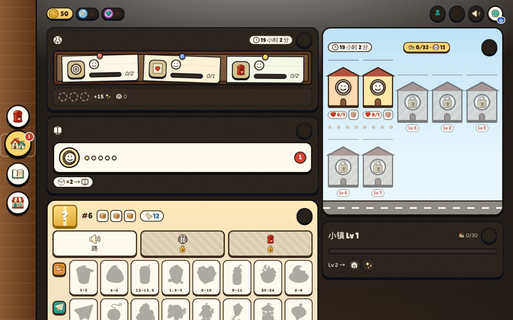
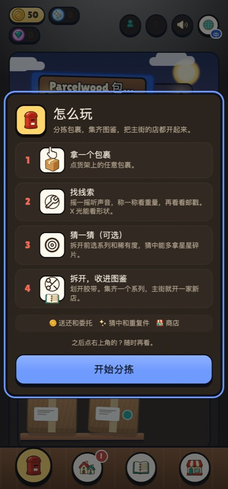

# Parcelwood（包裹镇）

一个在浏览器里玩的拆快递收藏小游戏。你在小镇驿站分拣包裹：先摇一摇、称一称、看邮戳，猜里面是什么，再划开胶带揭晓，把物件收进图鉴，慢慢让主街热闹起来。

> **项目已暂停（2026-11）。** 作者不再继续开发，代码和素材按 [MIT](LICENSE) 开源，欢迎拿去玩、学习，或改成你自己的游戏。线上的 Discord 版和后端已经下线。Issue 和 PR 不会有人回复。
>
> *A cozy browser game about sorting and unboxing parcels in a small town, written in TypeScript + Vite with no framework. Development has stopped and the project is shared as-is under the MIT License. Run it locally with `npm install && npm run dev`. The UI is available in English, Simplified Chinese and Spanish.*

<p align="center">
  
  
</p>

## 玩法

- **猜了再拆**：每个包裹有声音、重量、邮戳三条线索，X 光能看形状。拆开前猜系列和稀有度，猜中多拿碎片。
- **收藏**：物件按系列收集，有稀有度和保底，概率在游戏里公开。
- **小镇成长**：口碑攒够就升级，每一级会搬来新邻居或开放新玩法。邻居会发委托、收礼物，好感高了给福利。还有错寄件、加急件、无名件和每日事件。
- **每日内容**：每日之谜、每日任务和打卡，按日期生成，同一天所有人一样，不需要服务器。
- **急件高峰**：90 秒传送带分拣小游戏，每天一轮。
- **驿站一周**：五天的经营小模式（网页版）。
- **三种语言**：English、简体中文、Español。

## 本地运行

需要 Node.js 24（CI 用的版本，较新的 Node 一般也行）。

```bash
npm install
npm run dev        # 开发版，打开终端里给出的地址
```

不需要任何账号或环境变量：没配后端时，登录和存档都用浏览器里的本地模拟，进度存在浏览器里。开发版带开发者面板（在商店页），可以全部解锁、调运气、重置存档。

其他命令：

```bash
npm test           # 全部单元测试和界面测试（vitest + jsdom）
npm run typecheck
npm run build      # 网页版正式包，输出到 dist/
npm run sim        # 跑 1 万局模拟，检查数值和保底
```

## 三个构建

同一套游戏代码，打成三个入口：

| 构建 | 命令 | 说明 |
| --- | --- | --- |
| 网页版 | `npm run dev` / `npm run build` | 主版本。有账号、商店和本地测试广告。 |
| CrazyGames 版 | `npm run dev:crazygames` / `npm run build:crazygames` | 全年龄、不登录、不连自己的后端，接 CrazyGames SDK 的广告和存档。 |
| Discord Activity | `npm run dev:discord` / `npm run build:discord` | 已下线。代码保留，`dev:discord` 仍可用本地模拟跑起来。 |

`npm run check:release` 会检查两个上传包里没有混进网页版专属代码，并用 Playwright 在 10 种窗口尺寸下检查布局（需要本机有 Chromium）。

## 代码结构

```
src/
  core/        游戏规则，纯函数，不碰页面和网络（抽奖与保底、小镇、委托、每日之谜、急件高峰、存档校验……）
  ui/          页面、拆包动画、音乐和音效（Web Audio 合成）
  rush/        急件高峰（懒加载）
  week/        驿站一周
  i18n/        三语文案
  auth/        账号：Supabase 实现和本地模拟
  platform/    浏览器存储、标签页锁等设备差异
  crazygames/  CrazyGames 版入口和 SDK 封装
  discord/     Discord 版入口和 SDK 封装
public/        物件、居民、图标等图片（WebP / SVG）
art-source/    美术母版和出图提示词，不进构建
supabase/      后端的数据库迁移和 Edge Functions（服务已删除，仅作参考）
tests/         测试
qa/            布局和发布检查脚本
docs/          设计文档、美术规范、开发笔记
```

数值集中在 `src/core/config.ts`。存档在读取前都会经过 `src/core/sanitize.ts` 校验。

## 后端（可选）

游戏不需要后端也能完整运行。原来的线上版本用 Supabase 做账号、云存档和宝石余额，相关迁移和函数还在 `supabase/` 里。想自己接的话，把 `.env.example` 复制成 `.env.local`，填自己 Supabase 项目的地址和 publishable key，再按顺序跑 `supabase/migrations/`。原来的服务已经删除，这部分没人维护。

## 更多文档

- [docs/dev-notes.md](docs/dev-notes.md)：暂停前的完整开发笔记，包括每个系统的规则、账号和宝石逻辑、上线清单
- [docs/design-v2.md](docs/design-v2.md)：玩法改版设计
- [docs/art-bible.md](docs/art-bible.md)：美术风格规范和出图流程
- [docs/audio-credits.md](docs/audio-credits.md)：声音设计和授权

## 授权

代码和素材都按 [MIT](LICENSE) 开源。音乐和音效是运行时合成的原创内容；图标线条来自 Lucide；字体来自 Google Fonts（OFL）；物件和角色图由 AI 生成后人工筛选。详见 [CREDITS.md](CREDITS.md)。
